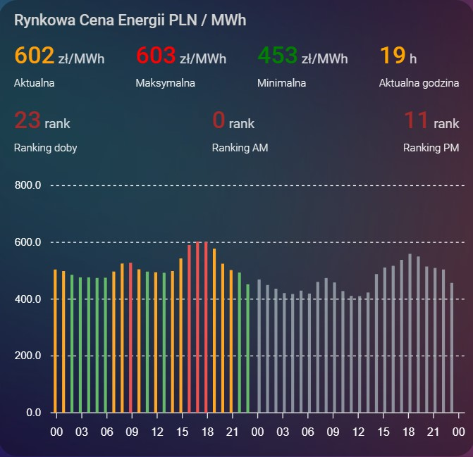

---
[](https://hacs.xyz/)
[](https://github.com/Tommyleesue/RCE-PSE-tommyleesue/blob/main/LICENSE)
[](https://github.com/Tommyleesue/RCE-PSE-tommyleesue/releases)
[](https://github.com/Tommyleesue/RCE-PSE-tommyleesue/commits/main)

# 🇵🇱 RCE-PSE_tommyleesue – Rynkowa Cena Energii (PLN/MWh)


Integracja **RCE PSE** dla **Home Assistant** udostępnia aktualne oraz prognozowane
**Rynkowe Ceny Energii Elektrycznej (RCE)** publikowane przez  
**Polskie Sieci Elektroenergetyczne (PSE)**.

Integracja opiera się na **jednym, rozbudowanym sensorze**, który dostarcza:
- aktualną cenę energii dla bieżącej godziny,
- pełne ceny godzinowe dla całej doby (1–24),
- ceny na jutro (publikowane po 14:30),
- rankingi tanich i drogich godzin,
- statystyki dobowo-czasowe,
- Możliwość dodatnia współczynnika podatkowego do ceny RCE
- dane gotowe do automatyzacji i wizualizacji.

---

## ✨ Funkcjonalności

- 📡 Dane bezpośrednio z **API PSE v2**
- ⏱️ Agregacja danych 15-minutowych do **godzin 1–24**
- 📊 Ranking cen doby (najtańsze / najdroższe godziny)
- 🌙 Podział **AM (1–12)** oraz **PM (13–24)**
- 🔥 Konfigurowalny zakres szczytu dobowego
- 📅 Ceny na jutro dostępne po godzinie **14:30**
- 🎨 Flagi tanich i drogich godzin (AM / PM) do kolorowania wykresów
- 🧠 Jeden sensor – wiele atrybutów

---

## 🧠 sensor.rce


### Wartość sensora
Aktualna cena energii dla **bieżącej godziny RCE**.

---

## 🧩 Atrybuty

### Statystyki doby
| Atrybut | Opis |
|------|------|
| `average` | średnia cena doby |
| `min` | najniższa cena |
| `max` | najwyższa cena |
| `mean` | mediana |
| `am_night_avg` | średnia 1–8 |
| `day_avg` | średnia 9–20 |
| `pm_night_avg` | średnia 21–24 |
| `custom_peak` | średnia z własnego zakresu |

---

### Bieżąca godzina
| Atrybut | Opis |
|------|------|
| `current_hour` | aktualna godzina (1–24) |
| `current_hour_rank` | ranking w dobie |
| `current_hour_percentile` | percentyl |
| `current_l_price` | flga zadeklarowanego rankingu tanich godzin |
| `current_h_price` | flga zadeklarowanego rankingu drogich godzin |
| `current_am_rank` | ranking przedpołudniowy |
| `current_pm_rank` | ranking popołudniowy |

---
## Podgląd karty ApexCharts

## Przykład kodu karty ApexCharts

<details>
<summary>Rozwiń aby zobaczyć kod konfiguracji apexcharts-card</summary>

```yaml
type: custom:apexcharts-card
graph_span: 48h
span:
  start: day
  offset: "-0h"
header:
  show: true
  title: Rynkowa Cena Energii PLN / MWh
  show_states: true
  colorize_states: true
update_interval: 1min
cache: false
apex_config:
  chart:
    height: 300
  legend:
    show: false
  xaxis:
    type: datetime
    labels:
      datetimeUTC: false
      format: HH
  yaxis:
    min: 0
series:
  - entity: sensor.rce
    show:
      in_header: true
      in_chart: false
    name: Aktualna
    float_precision: 0
    unit: " zł/MWh "
  - entity: sensor.rce
    show:
      in_header: true
      in_chart: false
    name: Maksymalna
    attribute: max
    float_precision: 0
    color: red
    unit: " zł/MWh "
  - entity: sensor.rce
    show:
      in_header: true
      in_chart: false
    name: Minimalna
    attribute: min
    float_precision: 0
    color: green
    unit: " zł/MWh "
  - entity: sensor.rce
    show:
      in_header: true
      in_chart: false
    name: Aktualna godzina
    attribute: current_hour
    float_precision: 0
    color: orange
    unit: " h"
  - entity: sensor.rce
    show:
      in_header: true
      in_chart: false
    name: Ranking doby
    attribute: current_hour_rank
    float_precision: 0
    color: brown
    unit: " rank"
  - entity: sensor.rce
    show:
      in_header: true
      in_chart: false
    name: Ranking AM
    attribute: current_am_rank
    float_precision: 0
    color: brown
    unit: " rank"
  - entity: sensor.rce
    show:
      in_header: true
      in_chart: false
    name: Ranking PM
    attribute: current_pm_rank
    float_precision: 0
    color: brown
    unit: " rank"
  - name: Dziś
    type: column
    entity: sensor.rce
    show:
      in_header: false
    extend_to: false
    data_generator: |
      var s = hass.states['sensor.rce'];
      if (!s?.attributes?.today_prices) {
        console.error('Brak today_prices');
        return [];
      }

      var todayStart = new Date();
      todayStart.setHours(0,0,0,0);

      var result = s.attributes.today_prices
        .filter(i => i.hour >= 1 && i.hour <= 24 && i.price !== null)
        .map(i => {
          var d = new Date(todayStart);
          if (i.hour === 24) {
            d.setDate(d.getDate() + 1);
            d.setHours(0,0,0,0);
          } else {
            d.setHours(i.hour,0,0,0);
          }
          
          // DEBUG: Sprawdź czy są flagi AM/PM
          console.log('Godzina', i.hour, ':', {
            price: i.price,
            am_h: i.am_h_price,
            am_l: i.am_l_price,
            pm_h: i.pm_h_price,
            pm_l: i.pm_l_price
          });
          
          // KOLORY WG FLAG AM/PM
          var color = '#FFA726'; // pomarańczowy - średnie (domyślnie)
          
          // Drogie godziny (AM LUB PM)
          if (i.am_h_price === true || i.pm_h_price === true) {
            color = '#EF5350'; // czerwony
          }
          // Tanie godziny (AM LUB PM)
          else if (i.am_l_price === true || i.pm_l_price === true) {
            color = '#66BB6A'; // zielony
          }
          // Reszta - zostaje pomarańczowy

          return {
            x: d.getTime() - (1 * 60 * 60 * 1000),
            y: i.price,
            fillColor: color
          };
        });

      console.log('Wygenerowano', result.length, 'punktów');
      return result;
  - name: Jutro
    type: column
    entity: sensor.rce
    show:
      in_header: false
    extend_to: false
    opacity: 0.7
    data_generator: |
      var s = hass.states['sensor.rce'];
      if (!s?.attributes?.tomorrow_prices) return [];

      var tomorrowStart = new Date();
      tomorrowStart.setHours(0,0,0,0);
      tomorrowStart.setDate(tomorrowStart.getDate() + 1);

      return s.attributes.tomorrow_prices
        .filter(i => i.hour >= 1 && i.hour <= 24 && i.price !== null)
        .map(i => {
          var d = new Date(tomorrowStart);
          if (i.hour === 24) {
            d.setDate(d.getDate() + 1);
            d.setHours(0,0,0,0);
          } else {
            d.setHours(i.hour,0,0,0);
          }

          return {
            x: d.getTime() - (1 * 60 * 60 * 1000),
            y: i.price,
            fillColor: '#B0BEC5',
            opacity: 0.7
          };
        });
```
</details>
